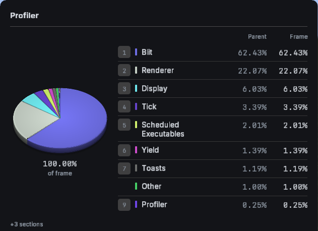

# macless

resizing, eyezoom, and useful f3 overlays for minecraft speedrunning. built for macos, windows, and linux, with the same dear imgui interface on each platform.



## get it

[download version 1.0.1](https://github.com/riye%2dprog/macless/releases/tag/v1.0.1). choose the jar matching minecraft 1.16.1 or 26.3, put it in your mods folder, and restart. fabric api is not required.

minecraft 26.3 needs java 25. minecraft 1.16.1 needs java 17 or newer. both require fabric loader 0.19.5 or newer and a compatible launcher runtime.

each jar includes native libraries for apple silicon, intel macs, windows x64, and linux x64 and arm64. macos targets version 14, although compatibility with macos 14 still needs runtime verification. linux requires glibc 2.28 or newer. additional capture dependencies and exact build settings are listed in [build details](approval/build.json).

26.3 supports opengl, vulkan, and metal through a compatible external mcopt backend. 1.16.1 uses opengl. support here does not establish approval for a renderer, launcher, or another mod.

## use it

ctrl+i or f8 opens the interface. f6 toggles thin, f7 wide, f9 eyezoom, f5 preemptive, and f10 fullscreen. shortcuts can be changed, combined into chords, or set to hold. gameplay shortcuts stay inactive in chat and normal menus.

resizing changes the actual game render target inside the existing window. the operating system window keeps its size. eyezoom magnifies that image beside the game viewport, with measuring labels from 1 to 9.

normal mouse scaling applies to both axes. eyezoom can override it with a measurement multiplier. requested values go up to 20x, while effective turn gain stays within vanilla sensitivity limits.

the profiler redraws the section selected through vanilla number keys. mapless appears when the selected section contains the block entity entry. neither searches hidden profiler branches. the entity counter uses the displayed f3 counter. unavailable data stays hidden.

overlay size, position, font, colors, opacity, padding, and visible content are editable under layout. click a numeric field to type a value, then press enter or leave the field to apply it. settings save automatically in `config/macless/`.

ninjabrain integration displays the bot's local api output. enable the api in the bot first. there is no ninjabrain overlay and no obs output route.

## approval status

this version is a candidate for moderator review. it is not approved for submitted runs.

[review notes](approval/readme.md) cover the seven pending rulings, the implemented restrictions, and the source entry points. [exact binary hashes](approval/artifacts.json), [validation evidence](approval/evidence/verification.json), and a [submission checklist](approval/checklist.json) are included. source publication and a passing test do not grant approval.

## build

use java 25, python 3, cmake 3.24 or newer, and a c++20 compiler. macos also needs freetype and libpng. the gradle wrapper verifies its distribution checksum.

```sh
./gradlew assemble :legacy:assemble check
```

the platform workflow builds five native targets and assembles both universal jars. [hosted checks](approval/evidence/hosted%2dbuild.json) passed for this source. detailed release and qa commands, dependency versions, and local verification setup are in [build details](approval/build.json). qa controllers and fixtures are excluded from release jars.

## license

mit. the original toolscreen notice and all bundled dependency and font notices are retained in [third party notices](native/licenses).
